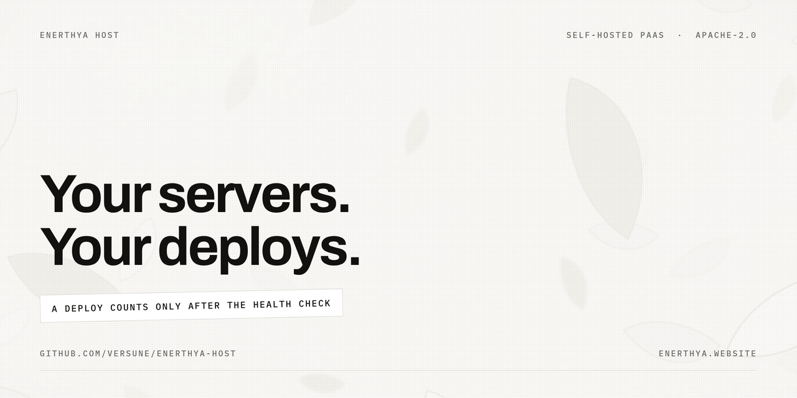
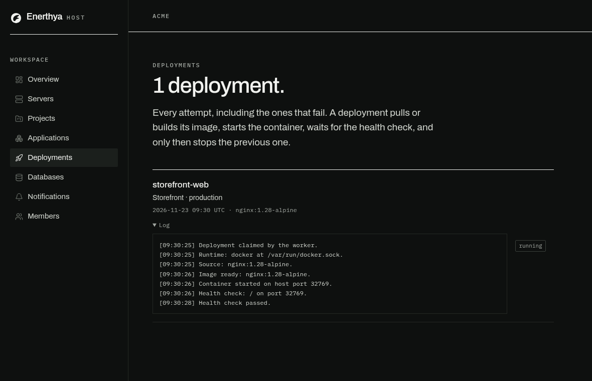
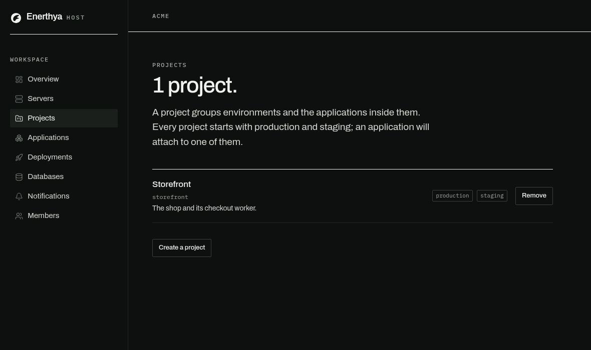

# Enerthya Host



An open-source, self-hosted PaaS. Connect your servers, point at a Git repository or a Docker
image, and Enerthya Host handles the build, the deploy, the domain, the TLS certificate, the
logs, the backups and the monitoring — on hardware you control.

Early build, but the loop is real. The monorepo, shared packages, authentication, servers,
projects, applications and the deployment pipeline work: a build, a health check, and only then
the swap. Domains and TLS, encrypted environment variables, real-time logs and a web terminal,
managed databases with scheduled backups verified by a restore, host and container metrics,
email notifications and team invitations are in place too. What is missing is listed under
Status, and a deployment that cannot finish says why instead of reporting success.

```sh
curl -fsSL https://raw.githubusercontent.com/Versune/enerthya-host/main/install.sh | sudo bash
```

Docker on a Debian or Ubuntu box; [what the installer does](#install) and [what is still
missing](#status).

## Architecture

| Path | Role |
|---|---|
| `apps/web` | Next.js 16 App Router dashboard and thin API. Enqueues work, never builds. |
| `apps/worker` | Separate Node process running BullMQ: builds, deploys, health checks, backups, metrics, cron. |
| `packages/core` | Domain logic — deploy engine, dockerode, ssh2, simple-git, execa, proxy config. |
| `packages/db` | Drizzle schema, migrations and the typed client (Postgres). |
| `packages/ui` | Shared shadcn/ui primitives. |
| `packages/config` | tsconfig presets and typed environment validation. |

Long deploys, WebSockets and background jobs never run inside a Next route handler.

## Development

Requirements: Node 24 or newer, pnpm 12, and Podman or Docker for the supporting services.

```sh
pnpm install
pnpm dev             # first run creates apps/web/.env with generated secrets
pnpm typecheck
pnpm lint
pnpm test
pnpm build           # standalone server under apps/web/.next/standalone
pnpm start
```

Database and queue commands (available once the schema lands):

```sh
pnpm db:generate
pnpm db:migrate
pnpm db:studio
```

## Releases

Versions follow Conventional Commits. On every push to `main`, release-please opens (or updates) a
release PR with the next version and the changelog; merging that PR tags `vX.Y.Z`, writes
`CHANGELOG.md` and publishes the GitHub release. A second workflow then builds the standalone
server and attaches `enerthya-host-vX.Y.Z.tar.gz` plus `SHA256SUMS`, the pair `install.sh`
downloads and verifies before extracting.

Nothing is published by hand, and `./install.sh --version vX.Y.Z` pins an older release.

## Configuration

| Variable | Meaning |
|---|---|
| `DATABASE_URL` | Postgres connection string |
| `REDIS_URL` | Redis connection string (BullMQ) |
| `BETTER_AUTH_SECRET` | Session signing secret |
| `ENCRYPTION_KEY` | 32-byte key for AES-256-GCM encryption of secrets at rest |
| `PORT` | Panel port (default `8420` in a source install) |
| `HOSTNAME` | Bind address; keep it loopback unless TLS terminates in front |

## What it looks like





## Install

One script per platform, Docker-only — no Node install on the host. The installer installs Docker
when missing, downloads and verifies the release, builds the panel image locally, starts Postgres,
Redis and the panel with Compose, applies migrations and waits for the healthcheck.

**Linux** (as root)

```sh
curl -fsSL https://raw.githubusercontent.com/Versune/enerthya-host/main/install.sh | sudo bash
```

**Windows:** use WSL2 with Docker Desktop and run the same command inside the WSL2 distro. **macOS:**
the same script works inside Docker Desktop or colima, since the stack is Docker-only.

Options: `--check` reports the host and installs nothing; `--version v0.3.0` pins a release;
`--bind` and `--port` choose where the panel listens (default `127.0.0.1:8420`). State lives in
`/data/enerthya`; rerunning the installer upgrades in place. See `docs/install.md` before exposing
it on a VPS.

Verify before installing, if you prefer:

```sh
curl -fsSL https://raw.githubusercontent.com/Versune/enerthya-host/main/install.sh -o install.sh
less install.sh && bash install.sh --check
```

## Status

- Works: pnpm workspace, typed packages, Biome, Vitest, standalone build, container-runtime
  detection, email/password sign-up and sign-in through better-auth, organizations created at
  sign-up, the dashboard shell, and a server registry: the local machine is always the first row,
  remote servers take an SSH key encrypted with AES-256-GCM, and a probe reports the runtime,
  pinning the SSH host key on first connect and refusing a changed one.
- Also works: projects with production and staging environments created in one step, applications
  attached to an environment with a Git repository or an image plus their build settings, and
  write endpoints guarded by the caller's role (owner/admin write, member reads).
- Also works: deployments. Pressing Deploy writes a deployment row and a BullMQ job; the worker
  pulls an image (or clones a repository and builds its Dockerfile), starts the container on a
  published port, waits for its health check, and only then stops the previous container for that
  application. A deployment that fails removes its own container and leaves the old one running.
- Also works: the installer ships that worker as an opt-in Compose profile (`--with-runtime`),
  because it mounts the host's container socket.
- Also works: domains with a generated Caddy config, the certificate issued and renewed by the
  proxy (the hop is proven on the host topology, not yet against a live DNS record), and
  environment variables encrypted at rest with a build-time/runtime split.
- Also works: real-time deploy logs and a web terminal carried over Postgres channels, the shell
  running as a TTY exec in the worker so the panel never holds the runtime socket.
- Also works: managed Postgres databases created in one step, scheduled backups to S3-compatible
  storage, each one verified by an actual restore, with an interval and a retention window per
  database.
- Also works: host metrics (CPU, memory, disk, uptime) and per-container CPU and memory, drawn
  from the live window; failure notifications over Discord, a generic webhook and email, the last
  rendered and sent by the worker so the relay credentials never reach the panel; members, roles
  and invitations.
- Not yet: Nixpacks and compose builds (refused with an explicit message), zero-downtime handover
  and resumable deployments, per-server metrics for remote hosts, service templates, and stored
  metrics history — the charts read the live window, not a series.

See `ROADMAP.md` for what ships next, `CLAUDE.md` for the architecture rules and the stage order,
and `PRODUCT.md` for product truth.

## Security

Secrets are encrypted at rest with AES-256-GCM. External commands run through `execa` argument
arrays, never through a shell string. Every input is validated with zod on both the API and the
form. The panel binds loopback by default, sends nothing to a third party, and refuses
cross-origin state-changing requests.

## Licence

Apache-2.0. Developed under Versune.
